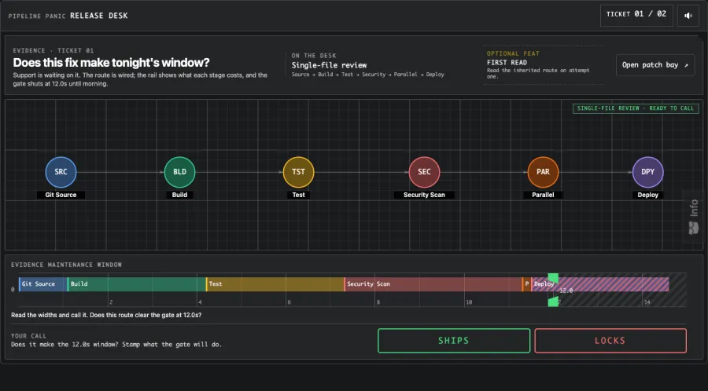
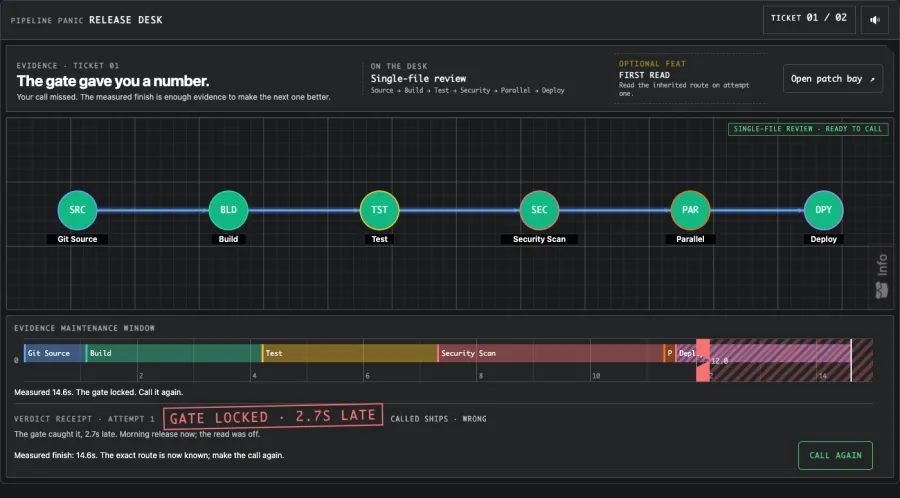

# Pipeline Panic


A small release judgment game. Read a CI/CD route and its 12-second maintenance window, call **SHIPS** or **LOCKS**, then see the measured result. The next ticket changes one rule, so the first answer no longer applies.



A correct call reveals the chain that set the finish time. There is also an optional patch bay for rewiring the route.



This is a two-ticket prototype, originally part of [edconde.com](https://edconde.com). It runs locally in the browser; there is no account or backend. More tickets would need player testing first.

## Run locally

```sh
npm ci
npm start
```

`npm run typecheck`, `npm run test:ci`, and `npm run build` check the code and production build. Built with Angular 21, TypeScript, Canvas, and Web Audio.

## License

Application code is [MIT licensed](LICENSE). Inline icon paths use the [Phosphor Icons license](third_party/PHOSPHOR-LICENSE).
